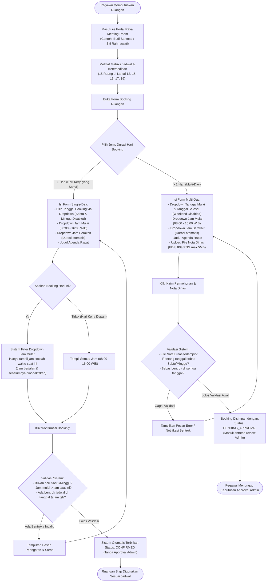
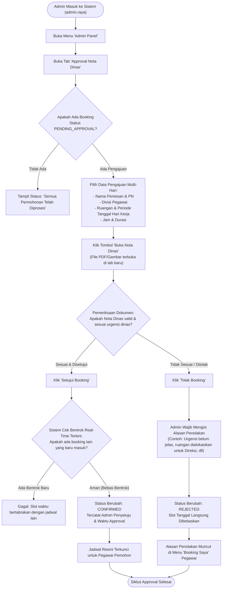
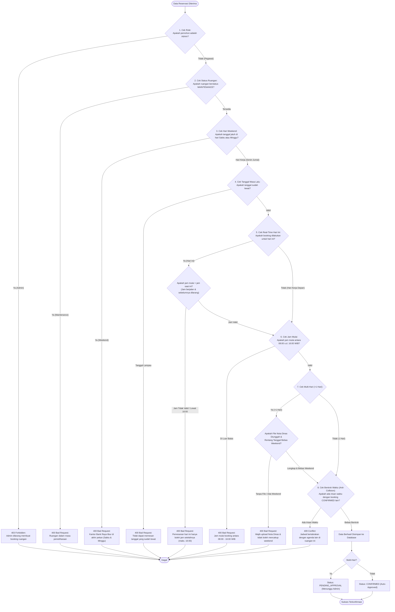
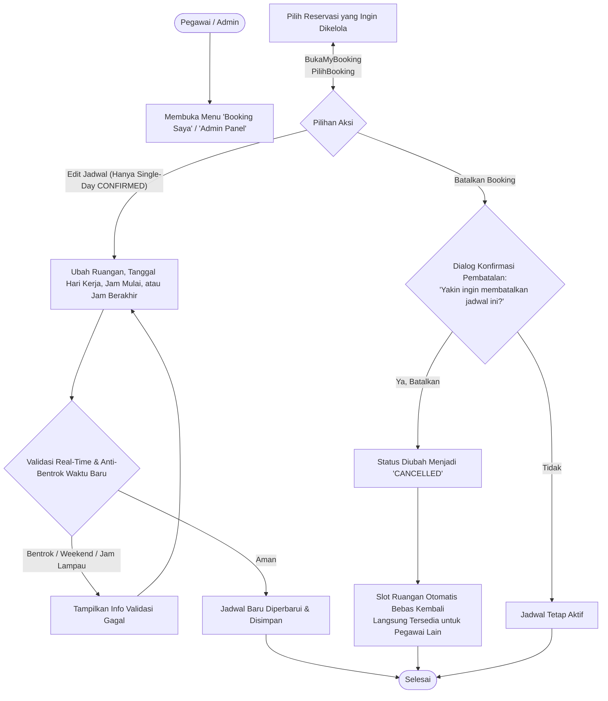
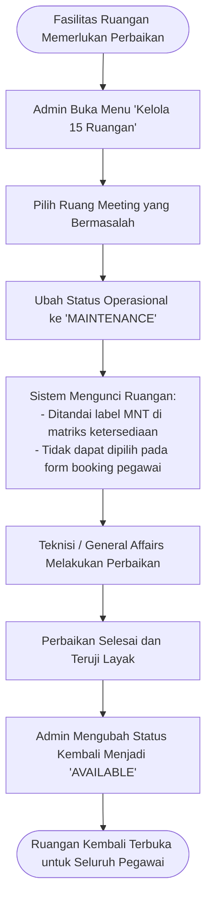
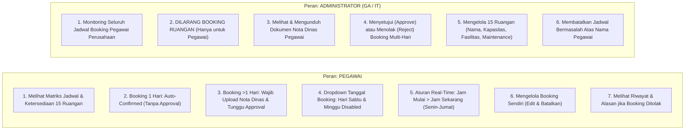

# 📋 Diagram Alur Bisnis (SOP): Sistem Reservasi Ruang Rapat Bank Raya

Dokumen ini memuat **alur proses bisnis**, **Standar Operasional Prosedur (SOP)**, dan **diagram flowchart resmi** penggunaan aplikasi *Meeting Room Booking System* PT Bank Raya Indonesia Tbk, yang telah disesuaikan dengan seluruh **ketentuan operasional real-time, aturan hari kerja, pembersihan data akhir pekan, dan antarmuka UI/UX terbaru**.

---

## 📌 Ketentuan Pokok Operasional & Bisnis (Terbaru)

1. **Hari Kerja Operasional & Larangan Booking Akhir Pekan (Weekend):**
   - Kantor operasional Bank Raya buka pada hari **Senin s.d. Jumat**.
   - **TIDAK BISA BOOKING SAAT WEEKEND (SABTU & MINGGU):** Backend memvalidasi kalender secara real-time. Sistem menolak pemesanan untuk hari Sabtu dan Minggu (baik booking 1 hari maupun dalam rentang multi-hari).
   - Seluruh data pemesanan di hari Sabtu dan Minggu telah dibersihkan secara permanen dari database.
2. **Dropdown Pemilihan Tanggal Booking (Weekend Disabled):**
   - Pemilihan tanggal booking pada form reservasi menggunakan **Dropdown (`<select>`)**.
   - Hari Sabtu dan Minggu ditandai `[AKHIR PEKAN - LIBUR]` dengan status **`disabled`**, sehingga tidak dapat diklik atau dipilih oleh pengguna.
3. **Ketentuan H+1 Hari Kerja (Business Day Logic):**
   - Perhitungan H+1 mengacu pada hari kerja berikutnya.
   - **Jika pegawai login / memesan pada hari Jumat**, maka opsi hari kerja berikutnya (**H+1**) jatuh pada hari **Senin** (melewati hari Sabtu dan Minggu). Tersedia tombol cepat *"Pilih H+1 Kerja (Senin)"*.
4. **Ketentuan Jam Booking di Hari yang Sama (Real-Time Hour Restriction):**
   - **Tidak bisa booking di jam saat ini ataupun sebelumnya:** Pemesanan di hari yang sama hanya dapat dimulai pada **jam setelahnya** (minimal `Jam_Sekarang + 1`:00 WIB). Contoh: jika waktu saat ini pukul 10:15 WIB, maka jam 10:00 dan jam sebelumnya (08:00, 09:00) tidak dapat dipilih; jam mulai paling awal adalah pukul 11:00 WIB.
   - **Batas Jam Mulai Maksimal:** Pukul **16:00 WIB**. Jika waktu saat ini sudah mencapai atau melewati pukul 16:00 WIB, pemesanan untuk hari ini otomatis ditutup dan pegawai diarahkan untuk memesan hari kerja berikutnya.
5. **Pemilihan Waktu Pertemuan:**
   - Pemilihan waktu menggunakan dropdown **Jam Mulai** (08:00 – 16:00 WIB) dan dropdown **Jam Berakhir** (durasi rapat 1–8 jam terhitung otomatis tanpa perlu memilih tombol durasi terpisah).
   - **Batas Jam Selesai:** **TIDAK ADA batasan jam selesai maksimal di 16:30 WIB**. Rapat yang dimulai pukul 16:00 WIB dapat berlangsung melewati jam kantor sesuai kebutuhan agenda.
6. **Aturan Booking 1 Hari (Single-Day):**
   - Pemesanan pada 1 hari kerja yang sama **TIDAK MEMERLUKAN APPROVAL ADMIN**.
   - Jadwal langsung terbit dengan status **CONFIRMED** secara otomatis jika tidak bentrok.
7. **Aturan Booking > 1 Hari (Multi-Day):**
   - Pemesanan lebih dari 1 hari kerja **WAJIB UPLOAD NOTA DINAS** (format PDF, JPG, atau PNG, maks. 5 MB) dan tidak boleh mencakup hari Sabtu atau Minggu.
   - Memerlukan **APPROVAL ADMIN** (*Status awal: PENDING_APPROVAL*). Slot baru resmi terkunci setelah diverifikasi dan disetujui Admin.
8. **Batasan Peran Admin (POV Admin):**
   - **Admin TIDAK BISA melakukan booking ruang meeting**. Jika Admin ingin memesan, pemesanan dilakukan melalui akun pegawai lain.
   - Sudut pandang (*POV*) Admin difokuskan murni untuk:
     1. Memantau matriks ketersediaan dan jadwal seluruh divisi.
     2. Meninjau Nota Dinas dan menyetujui/menolak permohonan booking multi-hari.
     3. Mengelola data 15 ruang meeting (kapasitas, fasilitas, dan status *maintenance*).
     4. Membatalkan booking bermasalah atas nama pegawai jika diperlukan.
9. **Struktur Navigasi Bersih & Branding:**
   - Menu **Dashboard ditiadakan**; pegawai dan admin langsung diarahkan ke menu operasional utama: **Jadwal & Ketersediaan**.
   - Header sidebar menampilkan **Logo Resmi Bank Raya Full Putih** dengan container berjarak lega (`mb-6` / 24px) sehingga subteks **"MEETING ROOM"** berada rapi di bawah tanpa tertimpa lengkungan senyum maupun teks `BRI group`.
   - Card Login menampilkan **Logo Resmi Bank Raya Biru Tua** (`#00529C`) dengan teks **"MEETING ROOM"** di bawahnya secara proporsional.

---

## 📑 Daftar Alur Proses Bisnis

1. [Alur 1: Reservasi Ruang Rapat oleh Pegawai (Dropdown Hari Kerja & Real-Time)](#1-alur-reservasi-ruang-rapat-oleh-pegawai-dropdown-hari-kerja--real-time)
2. [Alur 2: Proses Bisnis Admin (Approval & View Nota Dinas)](#2-proses-bisnis-admin-approval--view-nota-dinas)
3. [Alur 3: Aturan Bisnis Validasi Sistem (Real-Time, Weekend & Anti-Bentrok)](#3-aturan-bisnis-validasi-sistem-real-time-weekend--anti-bentrok)
4. [Alur 4: Perubahan Jadwal (Reschedule) & Pembatalan Booking](#4-perubahan-jadwal-reschedule--pembatalan-booking)
5. [Alur 5: Pemeliharaan Ruangan (Maintenance Lock) oleh Admin](#5-pemeliharaan-ruangan-maintenance-lock-oleh-admin)
6. [Alur 6: Matriks Kewenangan (Pegawai vs Admin)](#6-matriks-kewenangan-pegawai-vs-admin)
7. [Tabel Ringkasan SOP & Ketentuan Operasional](#tabel-ringkasan-sop--ketentuan-operasional)

---

## 1. Alur Reservasi Ruang Rapat oleh Pegawai (Dropdown Hari Kerja & Real-Time)

Diagram ini menggambarkan alur end-to-end pegawai saat memesan ruangan, termasuk percabangan reservasi 1 hari (auto-confirmed) dan >1 hari (wajib upload Nota Dinas & butuh approval Admin), pemilihan tanggal via dropdown dengan disabled weekend, serta validasi waktu real-time:

---

## 2. Proses Bisnis Admin (Approval & View Nota Dinas)

Diagram alur proses kerja Admin dalam meninjau booking multi-hari, melihat dokumen Nota Dinas, dan mengambil keputusan persetujuan/penolakan:

---

## 3. Aturan Bisnis Validasi Sistem (Real-Time, Weekend & Anti-Bentrok)

Urutan evaluasi logika backend saat sebuah reservasi didaftarkan atau disetujui:

---

## 4. Perubahan Jadwal (Reschedule) & Pembatalan Booking

Hak pegawai dan admin dalam mengelola reservasi yang telah dibuat:

---

## 5. Pemeliharaan Ruangan (Maintenance Lock) oleh Admin

Prosedur penguncian ruangan saat ada perbaikan AC, layar display, sound system, atau renovasi interior:

---

## 6. Matriks Kewenangan (Pegawai vs Admin)

Perbedaan hak akses dan wewenang operasional antara Pegawai dan Administrator:

---

## Tabel Ringkasan SOP & Ketentuan Operasional

Berikut tabel acuan operasional resmi untuk sistem reservasi ruang rapat Bank Raya:

| Aspek Operasional | Ketentuan Terbaru | Penjelasan & Alasan Bisnis |
| :--- | :--- | :--- |
| **Hari Operasional** | **Senin s.d. Jumat (Sabtu & Minggu Tutup)** | Kantor Bank Raya tutup pada akhir pekan. Backend secara real-time menolak pemesanan di hari Sabtu dan Minggu. Data booking lama di weekend telah dihapus. |
| **Pilihan Tanggal Booking** | **Dropdown dengan Disabled Weekend** | Dropdown tanggal otomatis mendisabled hari Sabtu & Minggu (`[AKHIR PEKAN - LIBUR]`) sehingga tidak dapat dipilih atau diklik oleh pengguna. |
| **Logika H+1 (Hari Kerja)** | **Jumat &rarr; Senin** | Jika pegawai memesan / login pada hari Jumat, opsi H+1 kerja berikutnya otomatis jatuh pada hari **Senin** (melewati Sabtu & Minggu). |
| **Pemesanan di Hari yang Sama** | **Jam Mulai &gt; Jam Saat Ini (Jam Setelahnya)** | Pegawai tidak dapat memesan jam saat ini atau jam sebelumnya. Paling awal adalah jam setelahnya (`currentHour + 1`:00 WIB). |
| **Batas Waktu Mulai** | **Pukul 08:00 – 16:00 WIB** | Jam mulai paling lambat adalah 16:00 WIB. Jika waktu sekarang sudah &ge; 16:00 WIB, pemesanan untuk hari ini ditutup. |
| **Batas Jam Selesai** | **Tidak Ada Batas Maksimal 16:30** | Rapat yang dimulai pukul 16:00 WIB dengan durasi panjang tetap diizinkan sesuai Jam Berakhir yang dipilih. |
| **Booking 1 Hari (Single-Day)** | **Auto-Approved (Tanpa Approval)** | Jika rapat hanya pada 1 hari kerja yang sama, jadwal langsung terbit dan terkonfirmasi otomatis (*CONFIRMED*). |
| **Booking > 1 Hari (Multi-Day)** | **Wajib Nota Dinas & Approval Admin** | Pemesanan beberapa hari kerja wajib mengunggah file Nota Dinas (PDF/JPG/PNG maks. 5 MB) dan disetujui Admin. |
| **Hak Booking Admin** | **Admin Dilarang Booking Ruangan** | Akun Admin difokuskan murni untuk monitoring, verifikasi nota dinas, dan approval. Untuk memesan, gunakan akun pegawai. |
| **Struktur Navigasi** | **Bebas Menu Dashboard** | Navigasi disederhanakan tanpa menu Dashboard; landing page langsung ke **Jadwal & Ketersediaan** 15 Ruangan. |
| **Header Sidebar Branding** | **Logo Bank Raya Full Putih + Margin 24px** | Container logo diberi jarak bawah lega (`mb-6`) sehingga teks **"MEETING ROOM"** berada rapi di bawah tanpa tertimpa lengkungan senyum maupun teks `BRI group`. |
| **Card Login Branding** | **Logo Bank Raya Biru Tua + MEETING ROOM** | Menggunakan logo resmi Bank Raya warna biru pekat (`#00529C`) dengan teks **"MEETING ROOM"** di bawahnya secara proporsional. |

---

&copy; 2026 PT Bank Raya Indonesia Tbk. Dokumen Standar Operasional & Alur Proses Bisnis Internal.
